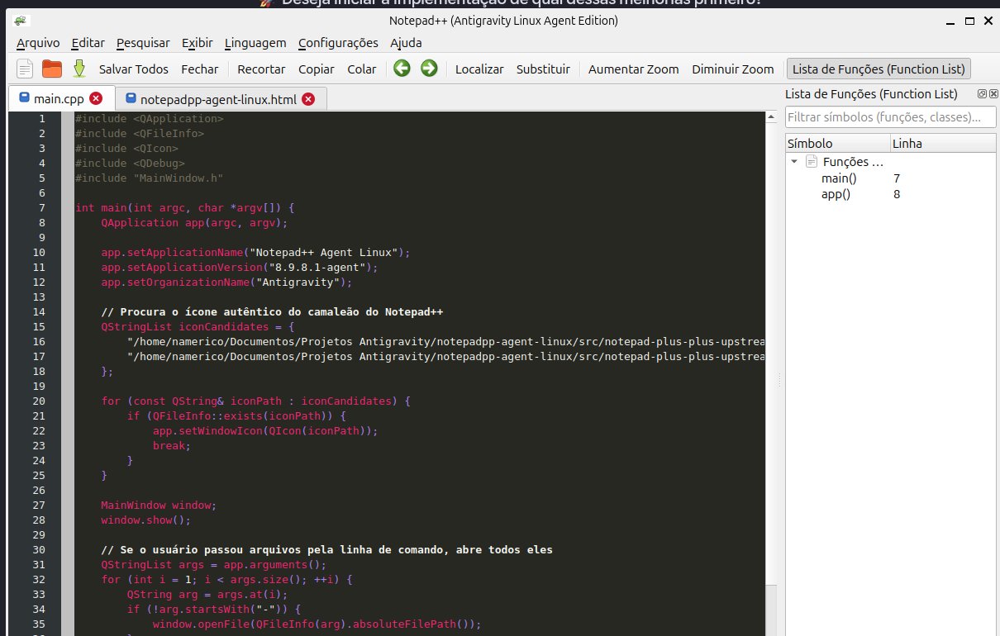
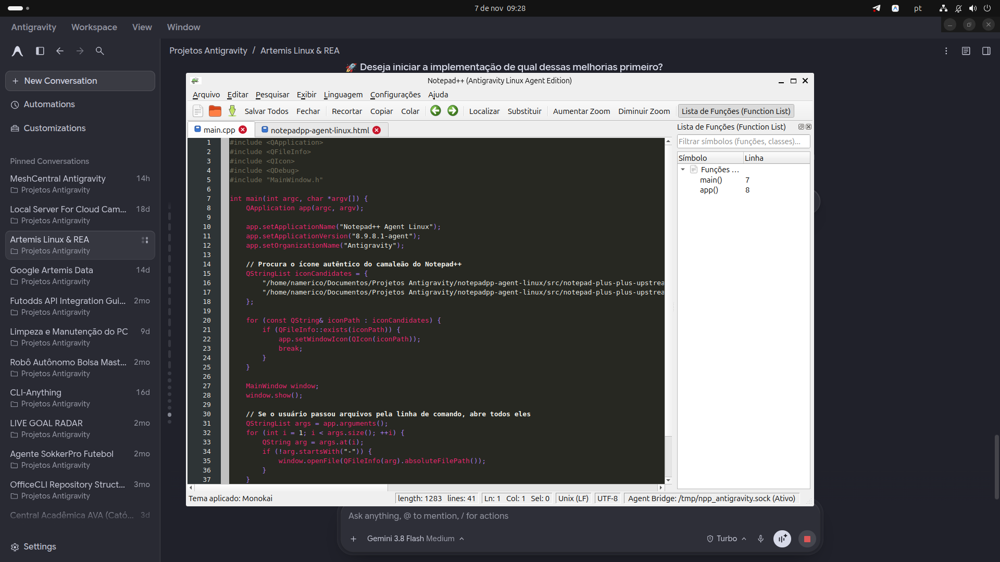
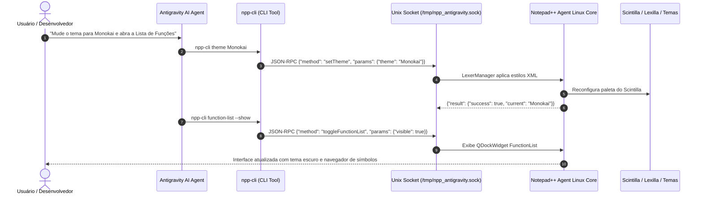

# 🦎 Notepad++ Agent-Native para Linux (Ecossistema Antigravity)

[](https://youtu.be/9DepaFVp-Os)
[](LICENSE)
[-orange.svg)](https://ubuntu.com)

> **Port nativo de alto desempenho do Notepad++ v8.9.8.1 para Linux impulsionado por C++17, Scintilla e Lexilla oficiais, equipado com o sistema oficial de 22 Temas XML, Painel Lateral Function List, Auto-Completion nativo e o barramento Agent Bridge IPC para controle bidirecional com o Google Antigravity e agentes de IA autônomos.**

---

## 🎬 Demonstração em Vídeo no YouTube

Assista à demonstração em vídeo do **Notepad++ Nativo no Linux** operado em tempo real pelos **Agentes de IA do Antigravity**:

[](https://youtu.be/9DepaFVp-Os)

▶️ **[Clique aqui para assistir no YouTube: FINALMENTE! Notepad++ Nativo no LINUX com AGENTES DE IA (Sem Wine!) 🚀🐧](https://youtu.be/9DepaFVp-Os)**

---



## 📌 Visão Geral & Diferenciais

O **Notepad++ Agent-Native para Linux** une os motores oficiais do Notepad++ (**Scintilla** para edição de texto de baixo nível e **Lexilla** para análise sintática de centenas de linguagens) a uma camada de interface moderna em **Qt5/C++17**, enriquecida por um barramento de comunicação entre processos (**Agent Bridge IPC**) via **Unix Domain Socket**.

Essa arquitetura permite que agentes de IA (como o **Antigravity**, **Artemis Linux** e subagentes autônomos) inspecionem arquivos abertos, leiam linhas específicas, apliquem diffs/patches cirúrgicos, troquem temas ao vivo e enviem notificações visuais diretamente para a janela do editor em tempo real enquanto o usuário programa.

---

## 🎨 Novas Funcionalidades Integradas (Tríade REA + Craft Anything + Artemis)

### 1. 🌈 Suporte Completo aos 22 Temas Oficiais do Notepad++
Utilizando a engenharia de estilos do Notepad++, o editor lê e processa os temas XML originais, mapeando paletas de cores RGB/BGR diretamente para o Scintilla:
* **Temas inclusos:** `Monokai`, `Obsidian`, `Solarized`, `Zenburn`, `Bespin`, `Deep Black`, `Choco`, `Twilight`, `Vibrant Ink`, `Plastic Code Wrap`, `Ruby Blue`, `DarkModeDefault`, `Hello Kitty`, `HotFudgeSundae`, `Mono Industrial`, `MossyLawn`, `Navajo`, `khaki`, `vim Dark Blue`, entre outros.
* **Troca instantânea:** Disponível pelo menu `Configurações -> Temas` ou programaticamente via CLI/agente (`npp-cli theme Monokai`).

### 2. 🌲 Painel Lateral Function List (Navegador de Classes e Funções)
* Painel lateral acoplável e retrátil (`QDockWidget`) integrado com busca e filtro em tempo real.
* Detecta automaticamente classes, métodos, estruturas e funções para **C/C++, Python, JavaScript, TypeScript, PHP, Rust, Go, Java, Bash**, etc.
* **Navegação com 1 clique:** Dê um clique duplo em qualquer símbolo da lista para saltar imediatamente para a respectiva linha de código.
* Atalho rápido: `Ctrl + Alt + L` ou via comando `npp-cli function-list --show`.

### 3. ⚡ Auto-Completion Nativo com Dicionários Oficiais
* Integração com mais de 30 dicionários XML de palavras-chave oficiais do Notepad++ (`autoCompletion/*.xml`).
* Disparo automático inteligente no Scintilla com `SCI_AUTOCSHOW` ao digitar identificadores.

### 4. 🛡️ Suíte de Auditoria e Testes do Artemis Linux (`tests/artemis_ui_audit.py`)
* Rotina automatizada que valida o ciclo completo de UI, troca de temas, acoplamento de painéis, injeção de código e barramento IPC.

---

## 📸 Demonstração Visual no Desktop

Abaixo está o registro da aplicação rodando com o tema **Monokai** e a **Function List** ativa ao lado do chat do Antigravity no **Ubuntu 26.04 / GNOME Shell**:



---

## 🧠 Como os Agentes Funcionam e Interagem



### Protocolo Agent Bridge IPC
O editor expõe um endpoint local em:
```
/tmp/npp_antigravity.sock
```
A comunicação utiliza o padrão **JSON-RPC 2.0** delimitado por quebra de linha (`\n`), garantindo latência inferior a **2 milissegundos** por comando.

---

## 🛠️ CLI Unificada: `npp-cli`

```bash
# 1. Verificar status da instância
npp-cli ping

# 2. Listar todas as abas abertas
npp-cli tabs

# 3. Listar os 22 temas oficiais disponíveis
npp-cli themes

# 4. Alternar o tema do editor ao vivo
npp-cli theme Monokai
npp-cli theme Obsidian
npp-cli theme Solarized

# 5. Exibir ou ocultar o painel Function List
npp-cli function-list --show
npp-cli function-list --hide

# 6. Abrir um arquivo na linha 42
npp-cli open "/caminho/do/script.py" --line 42

# 7. Obter o código do buffer ativo
npp-cli get

# 8. Criar uma nova aba com código
npp-cli new --text "print('Olá do Notepad++ no Linux!')"

# 9. Renomear uma aba aberta
npp-cli rename "meu_modulo.py"

# 10. Aplicar um patch atômico de substituição
npp-cli patch --start 120 --len 25 --replace "nova_funcao()"

# 11. Salvar o documento ativo
npp-cli save

# 12. Enviar notificação na barra de status
npp-cli notify "Refatoração concluída pelo Antigravity!"

# 13. Persistência de Sessão
npp-cli session-save
npp-cli session-load
```

---

## 🤖 Servidor MCP Nativo (`npp-mcp`)

O projeto inclui um servidor **Model Context Protocol (MCP)** completo em `mcp-server/npp_mcp.py`, expondo 17 ferramentas para agentes de IA:

* `npp_ping`: Healthcheck e PID.
* `npp_list_tabs`: Lista de abas e metadados.
* `npp_open_file`: Abertura de arquivos com foco de linha.
* `npp_get_active_buffer`: Leitura integral do buffer ativo.
* `npp_set_active_buffer`: Substituição total de texto.
* `npp_insert_text`: Inserção na posição do cursor.
* `npp_apply_diff`: Patch atômico e cirúrgico no Scintilla.
* `npp_new_tab`: Criação de aba vazia.
* `npp_save_active_file`: Salvamento em disco.
* `npp_set_theme`: Aplicação dinâmica de temas visuais.
* `npp_toggle_function_list`: Controle do painel Function List.
* `npp_show_notification`: Notificação na barra de status.
* `npp_save_session` / `npp_load_session`: Gestão de sessões XML.

---

## 🏗️ Estrutura do Repositório

```
notepadpp-agent-linux/
├── bin/
│   └── npp-cli                  # CLI executável e cliente JSON-RPC
├── mcp-server/
│   ├── npp_mcp.py               # Servidor nativo MCP (Model Context Protocol)
│   └── README.md                # Guia de configuração para agentes de IA
├── docs/
│   ├── PROJETO_NOTEPADPP_ANTIGRAVITY_LINUX.md # Documentação da arquitetura
│   └── images/
│       ├── notepadpp_monokai_window.png       # Print da janela com Monokai e Function List
│       ├── notepadpp_monokai_functionlist.png # Print do desktop completo
│       ├── notepadpp_window.png               # Print da janela em modo claro
│       └── notepadpp_running.png              # Print do desktop em modo claro
├── src/
│   └── npp-linux/
│       ├── assets/
│       │   ├── themes/          # 22 temas oficiais em XML (Monokai, Obsidian, etc.)
│       │   ├── autoCompletion/  # 34 dicionários oficiais de palavras-chave
│       │   ├── functionList/    # 48 regras XML oficiais de extração de símbolos
│       │   └── icons/           # Ícone autêntico do camaleão do Notepad++
│       ├── AgentBridge.h/.cpp   # Servidor Unix Domain Socket (JSON-RPC) com buffer anti-fragmentação
│       ├── EditorTab.h/.cpp     # Gerenciamento de abas, Scintilla e Auto-Completion
│       ├── FunctionListDock.h/.cpp # Painel lateral de navegação com regras XML oficiais
│       ├── LexerManager.h/.cpp  # Carregador de sintaxes Lexilla e temas XML
│       ├── MainWindow.h/.cpp    # Janela principal, sessão persistente session.xml e menus
│       ├── main.cpp             # Ponto de entrada com carregamento automático de sessão
│       └── CMakeLists.txt       # Script de compilação CMake
├── tests/
│   └── artemis_ui_audit.py      # Suíte de auditoria e testes do Artemis Linux
├── notepadpp-agent-linux.html   # Exemplo demonstrativo gerado pelo agente
├── .gitignore
└── README.md
```

---

## 🚀 Como Compilar e Rodar

### Pré-requisitos
No Ubuntu / Debian:
```bash
sudo apt update
sudo apt install build-essential cmake ninja-build qtbase5-dev libqt5widgets5 libqt5network5
```

### Compilação do Núcleo
```bash
cd src/npp-linux
mkdir build && cd build
cmake ..
make -j$(nproc)
```

### Executar a Suíte de Testes do Artemis Linux
```bash
python3 tests/artemis_ui_audit.py
```

### Execução do Editor
```bash
./notepadpp-agent
# ou globalmente no sistema:
notepadpp
```

---

## 📄 Licença
Distribuído sob a licença **GPLv3**, em conformidade com o projeto original do Notepad++ e do motor Scintilla.
