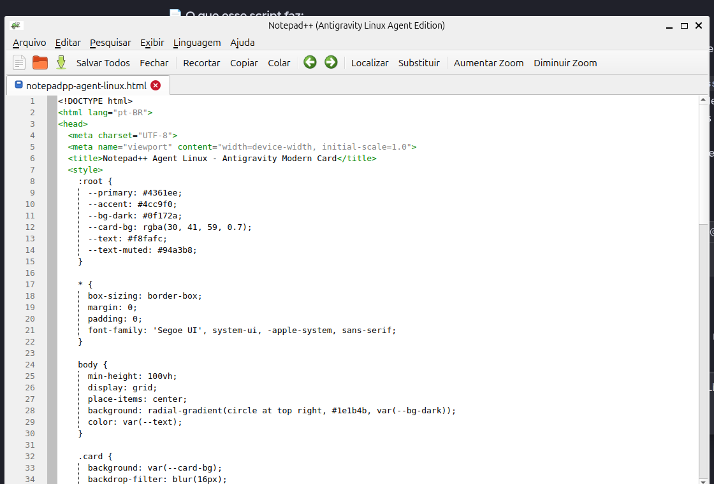
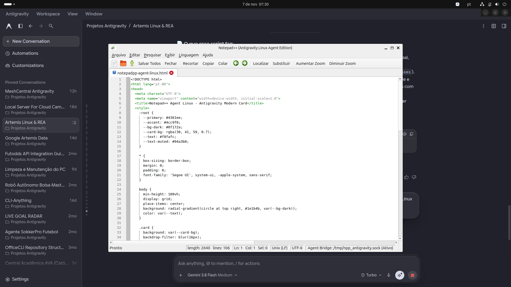
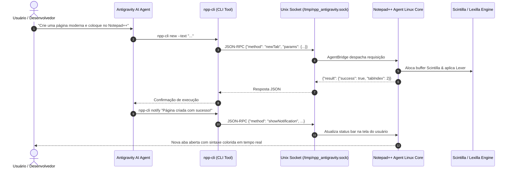

# 🦎 Notepad++ Agent-Native para Linux (Ecossistema Antigravity)

> **Port nativo de alto desempenho do Notepad++ v8.9.8.1 para Linux impulsionado por C++17, Scintilla e Lexilla oficiais, equipado com uma ponte IPC inteligente (Agent Bridge) para integração profunda e bidirecional com o ecossistema Google Antigravity e agentes de IA autônomos.**

---



## 📌 Visão Geral

O **Notepad++ Agent-Native para Linux** não é um mero wrapper Wine ou uma cópia simplificada. Trata-se de uma engenharia de portabilidade direta que une os motores oficiais do Notepad++ (**Scintilla** para edição de texto de baixo nível e **Lexilla** para análise sintática de centenas de linguagens) a uma camada de interface moderna em **Qt5/C++17**, enriquecida por um barramento de comunicação entre processos (**Agent Bridge IPC**) via **Unix Domain Socket**.

Essa arquitetura permite que agentes de IA (como o **Antigravity**, **Artemis Linux** e subagentes autônomos) inspecionem arquivos abertos, leiam linhas específicas, apliquem diffs/patches cirúrgicos e enviem notificações visuais diretamente para a janela do editor em tempo real enquanto o usuário programa.

---

## 📸 Demonstração Visual no Desktop

Abaixo está o registro da aplicação rodando nativamente no **Ubuntu 26.04 / GNOME Shell** sob Wayland, com o agente Antigravity escrevendo código ao vivo e gerenciando documentos abertos:



---

## 🧠 Como os Agentes Funcionam e Interagem

O grande diferencial deste projeto é a integração nativa com agentes autônomos de IA. Os agentes deixam de ser simples assistentes de chat isolados e passam a ter **presença ativa e controle programático** sobre o ambiente de edição do usuário.



### 1. Protocolo Agent Bridge IPC
O editor expõe um endpoint local em:
```
/tmp/npp_antigravity.sock
```
A comunicação utiliza o padrão **JSON-RPC 2.0** delimitado por quebra de linha (`\n`), garantindo latência inferior a **2 milissegundos** por comando:

```json
// Exemplo de requisição enviada pelo Agente:
{
  "jsonrpc": "2.0",
  "id": 101,
  "method": "getActiveBuffer",
  "params": {}
}

// Resposta retornada instantaneamente pelo Notepad++:
{
  "jsonrpc": "2.0",
  "id": 101,
  "result": {
    "tabIndex": 0,
    "title": "main.cpp",
    "filePath": "/home/namerico/projeto/main.cpp",
    "isModified": false,
    "lineCount": 42,
    "currentLine": 15,
    "currentColumn": 4,
    "text": "#include <iostream>..."
  }
}
```

### 2. Métodos RPC Disponíveis para Agentes
| Método | Parâmetros | Descrição |
| :--- | :--- | :--- |
| `ping` | `{}` | Verifica se o editor está vivo, retornando versão, PID e abas. |
| `listTabs` | `{}` | Lista todas as abas abertas com seus títulos, caminhos e status. |
| `switchTab` | `{"index": N}` | Alterna a aba ativa para o índice especificado. |
| `newTab` | `{"text": "..."}` | Cria uma nova aba imediatamente com texto opcional. |
| `renameTab` | `{"index": N, "title": "..."}` | Renomeia dinamicamente o título exibido na aba. |
| `openFile` | `{"path": "...", "line": N}` | Abre um arquivo do disco e salta para a linha desejada. |
| `getActiveBuffer`| `{}` | Obtém todo o conteúdo do buffer atual, seleção e posição do cursor. |
| `setActiveBuffer`| `{"text": "..."}` | Substitui o texto do arquivo aberto. |
| `insertText` | `{"text": "..."}` | Insere texto na posição atual do cursor. |
| `applyDiff` | `{"startPos": N, "len": N, "replacement": "..."}` | Aplica alterações e patches cirúrgicos sem corromper o restante do arquivo. |
| `saveActiveFile` | `{}` | Grava as alterações do arquivo ativo no disco. |
| `closeTab` | `{"index": N}` | Fecha uma aba específica ou ativa. |
| `showNotification` | `{"message": "...", "timeout": N}` | Mostra mensagens e avisos do agente no rodapé da janela. |

---

## 🛠️ CLI Unificada: `npp-cli`

Para facilitar tanto o uso por scripts shell quanto a chamada pelos agentes, o projeto acompanha a ferramenta central `npp-cli`:

```bash
# Verificar status da instância
npp-cli ping

# Listar todas as abas abertas
npp-cli tabs

# Abrir um arquivo na linha 42
npp-cli open "/caminho/do/script.py" --line 42

# Obter o código do buffer ativo
npp-cli get

# Criar uma nova aba com código
npp-cli new --text "print('Olá do Notepad++ no Linux!')"

# Renomear uma aba aberta
npp-cli rename "meu_modulo.py"

# Aplicar um patch atômico de substituição
npp-cli patch --start 120 --len 25 --replace "nova_funcao()"

# Salvar o documento ativo
npp-cli save

# Enviar notificação na barra de status
npp-cli notify "Refatoração concluída pelo Antigravity!"
```

---

## 🏗️ Estrutura do Repositório

```
notepadpp-agent-linux/
├── bin/
│   └── npp-cli                  # CLI executável e cliente JSON-RPC
├── docs/
│   └── images/
│       ├── notepadpp_window.png # Print em alta resolução da janela
│       └── notepadpp_running.png# Print completo do desktop rodando
├── src/
│   └── npp-linux/
│       ├── AgentBridge.h/.cpp   # Servidor Unix Domain Socket (JSON-RPC)
│       ├── EditorTab.h/.cpp     # Gerenciamento de abas e motor Scintilla
│       ├── LexerManager.h/.cpp  # Carregador de sintaxes Lexilla (100+ linguagens)
│       ├── MainWindow.h/.cpp    # Janela principal, menus, toolbar e statusbar
│       ├── main.cpp             # Ponto de entrada da aplicação
│       └── CMakeLists.txt       # Script de compilação CMake
├── notepadpp-agent-linux.html   # Exemplo demonstrativo gerado pelo agente
├── .gitignore
└── README.md
```

---

## 🚀 Como Compilar e Rodar

### Pré-requisitos
No Ubuntu / Debian:
```bash
sudo apt update
sudo apt install build-essential cmake ninja-build qtbase5-dev libqt5widgets5 libqt5network5
```

### Compilação do Núcleo
```bash
cd src/npp-linux
mkdir build && cd build
cmake ..
make -j$(nproc)
```

### Execução
```bash
./notepadpp-agent
```

Ou utilizando o atalho configurado globalmente:
```bash
notepadpp
```

---

## 📄 Licença
Distribuído sob a licença **GPLv3**, em conformidade com o projeto original do Notepad++ e do motor Scintilla.
