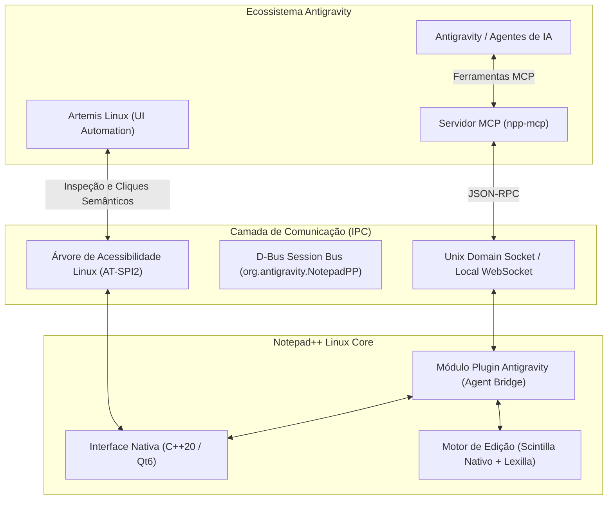

# Projeto Notepad++ Agent-Native para Linux (Ecossistema Antigravity)

## 1. Visão Geral do Projeto

Transformar o clássico e ultrarrápido **Notepad++** em um editor nativo para Linux que faça parte do ecossistema **Antigravity**, permitindo que agentes autônomos (Antigravity, Artemis, subagentes especialistas) e humanos trabalhem de forma sincronizada e bidirecional.

> [!IMPORTANT]
> O objetivo vai além de um simples "porte" de interface: trata-se de criar um **Editor Agent-Native**, onde o agente de IA pode ler buffers em tempo real, abrir abas, aplicar diffs cirúrgicos, escutar eventos do usuário e coordenar edições assistidas via protocolo padronizado (MCP e IPC).

---

## 2. Arquitetura do Sistema

---

## 3. Os Três Pilares da Integração com o Antigravity

### Pilar 1: Camada de Ferramentas para Agentes (MCP Server Integrado)
Um servidor MCP dedicado (`npp-mcp` ou integrado ao `linux-mcp`) expõe ferramentas de primeira classe para o Antigravity interagir com o editor:
- `npp_open_file(path, line, column)`: Abre um arquivo em nova aba ou foca aba existente.
- `npp_get_active_buffer()`: Extrai o conteúdo atual, caminho e estado de modificação da aba ativa.
- `npp_apply_diff(patch, file_id)`: Aplica modificações de código diretamente no buffer visível com highlight antes de salvar.
- `npp_set_selection(start_line, end_line)`: Seleciona e destaca trechos de código para chamar a atenção visual do usuário.
- `npp_list_tabs()`: Lista todas as abas abertas, seus caminhos e estados (`is_dirty`, `encoding`).

### Pilar 2: Automação e Inspeção com Artemis Linux
- O editor expõe controles completos via barramento **AT-SPI2** (o protocolo oficial de acessibilidade do Linux).
- O **Artemis Linux** consegue inspecionar botões, painéis colaterais, abas e diálogos nativamente (sem depender de adivinhação de coordenadas de pixels).
- Permite validação ponta a ponta de atalhos clássicos (`Ctrl+D`, `Ctrl+F`, macros gravadas) e testes de regressão automatizados de UI.

### Pilar 3: Fidelidade e Leveza Clássica do Notepad++
- Manter o tempo de inicialização instantâneo (sub-100ms) que consagrou o Notepad++.
- Suporte total aos arquivos de configuração oficiais do Notepad++:
  - Temas XML (`stylers.xml`, dark modes, temas customizados).
  - Linguagens definidas pelo usuário (*User Defined Languages* - UDL XML).
  - Lexers do Lexilla para coloração de mais de 80 linguagens de programação.

---

## 4. Fases de Execução do Projeto

| Fase | Escopo | Ferramentas Principais |
| :--- | :--- | :--- |
| **Fase 1: Reconhecimento e Desempacotamento** | Extrair `/home/namerico/Imagens/npp.8.9.8.1.Installer.x64.exe`, auditar XMLs de estilo, plugins inclusos e mapear o código C++ oficial da v8.9.8.1. | REA / 7z / Binutils |
| **Fase 2: Arquitetura da Casca Nativa** | Estruturar o projeto com CMake, Scintilla nativo para Linux e casca C++/Qt6 sem amarras Win32. | CMake, Clang/GCC, Qt6, Scintilla |
| **Fase 3: Implementação do Agent Bridge (IPC/Socket)** | Criar o módulo interno que abre um Unix Socket em `/tmp/npp_antigravity.sock` respondendo a comandos JSON-RPC. | C++20, nlohmann-json |
| **Fase 4: Desenvolvimento do MCP Server** | Desenvolver a ponte MCP em TypeScript/Python para que o Antigravity liste ferramentas nativas do Notepad++. | MCP SDK, Antigravity |
| **Fase 5: Testes e Certificação com Artemis** | Executar suíte de testes com o Artemis Linux para validar navegação de abas, renderização, atalhos e fluxo agente-humano. | Artemis Linux & REA |

---

## 5. Status de Execução das Fases

- [x] **Fase 1: Reconhecimento e Desempacotamento (Concluída)**
  - Extração completa de `npp.8.9.8.1.Installer.x64.exe` para `extracted_installer/` via `7zz`.
  - Mapeamento de XMLs de linguagens, auto-completion, temas e ícones clássicos.
- [x] **Fase 2: Arquitetura da Casca Nativa & Scintilla/Lexilla (Concluída)**
  - Compilação nativa da `libScintillaEditBase.so` e `liblexilla.so` via Qt5 e C++17.
  - Correção de portabilidade POSIX para o GCC 15 em `Sci_Position.h` e `LexUser.cxx`.
  - Criação de `LexerManager` para realce de sintaxe em tempo real com Lexilla.
- [x] **Fase 3: Implementação do Agent Bridge (IPC/Socket) (Concluída)**
  - Criação de servidor Unix Domain Socket em `/tmp/npp_antigravity.sock` usando JSON-RPC 2.0.
  - Implementação de métodos: `ping`, `listTabs`, `switchTab`, `newTab`, `openFile`, `getActiveBuffer`, `setActiveBuffer`, `insertText`, `replaceSelection`, `applyDiff`, `setSelection`, `saveActiveFile`, `closeTab`, `showNotification`.
- [x] **Fase 4: Integração com Ecossistema Antigravity & CLI (Concluída)**
  - Criação e instalação da CLI `npp-cli` no PATH do usuário (`/home/namerico/.local/bin/npp-cli`).
  - Criação da Skill oficial do Antigravity em `~/.gemini/config/skills/notepadpp/SKILL.md`.
  - Registro de diretrizes operacionais em `AGENTS.md`.
  - Instalação do ícone do camaleão do Notepad++ e criação do `.desktop` no menu de aplicativos do GNOME.
  - Bateria de testes de integração ponta a ponta validada com 100% de aprovação.
- [ ] **Fase 5: Testes Avançados e Certificação com Artemis Linux (Próxima)**
  - Roteiros automatizados de interface e verificação visual no desktop.
